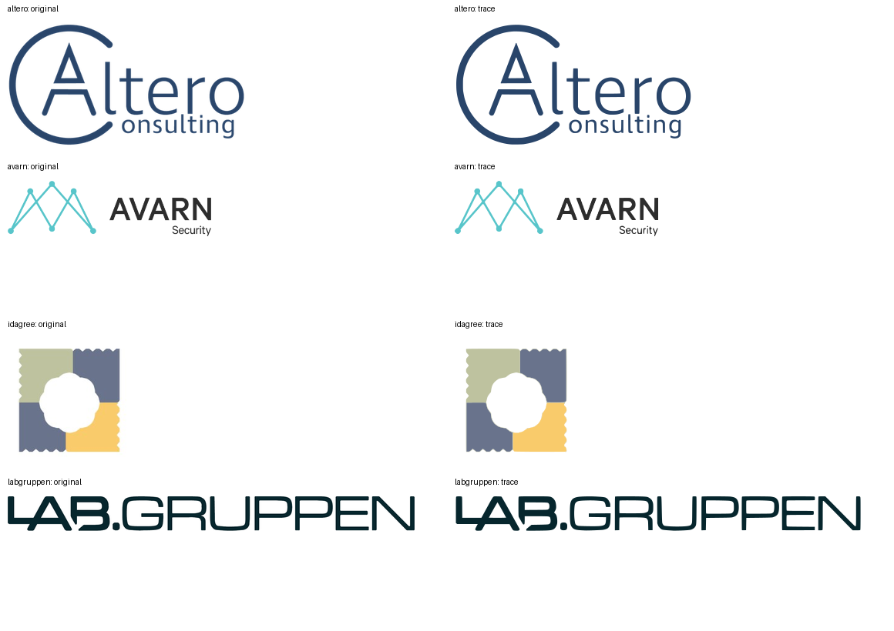

# Company logo sources

Audit for issue #52, 16 October 2026. Preserve the logo identity used during the
engagement; a current rebrand is not automatically the same artwork.

| Logo | Result |
| --- | --- |
| Carmenta | Already SVG: `company_logo_carmenta.svg`. |
| RE:Base / RE:IT | Already SVG: `company_logo_reit.svg`. |
| Mentice | Already SVG: `company_logo_mentice.svg`. |
| Consilium | Already SVG: `company_logo_consilium.svg`. |
| Ericsson | Already SVG: `company_logo_ericsson.svg`. |
| Carnegie | Replaced raster with the matching historical red wordmark from [Wikimedia Commons](https://commons.wikimedia.org/wiki/File:Carnegie_Investment_Bank_logo.svg), which attributes the artwork to Carnegie Investment Bank and the source to carnegie.se. Download: https://upload.wikimedia.org/wikipedia/commons/a/a1/Carnegie_Investment_Bank_logo.svg. Current carnegie.se serves a different DNB Carnegie brand. |
| IMY | Downloaded the [official full logo SVG](https://www.imy.se/Static/dist/d8f11c23f74e7124c698.svg), including the agency name. Changed only its white fill (`#FFFFFF`) to `#003b49`, matching the previous raster logo. |
| Altero Consulting | Matching vector not found on the [official site](https://www.alteroconsulting.com/). Traced the retained PNG in its original blue (`#29456a`). |
| AVARN Security | Matching vector not found on the [official site](https://www.avarnsecurity.se/). Traced the retained PNG, including the turquoise symbol, dark wordmark and Security tagline. |
| CELLINK | Replaced the trace with the official full CELLINK / A BICO COMPANY SVG supplied by the owner in [PR #55](https://github.com/DanOpcode/kalyna.se/pull/55#issuecomment-6210255965). [Original attachment](https://github.com/user-attachments/assets/f7ffd46b-f658-4b47-b403-d750926d3485). Changed only the white fill to black for the white logo card. Excluded from the tracing script so regeneration preserves this artwork. |
| Lab Gruppen | [Official downloads](https://www.labgruppen.com/) returned HTTP 403. Traced the retained PNG in its original dark teal (`#06262d`). |
| IdAgree | Candidate domains failed DNS resolution or timed out. Traced the retained JPEG using its three original flat colours. |

## Traced artwork

The four traces above are approximations of the retained raster artwork, not
company-supplied vector masters. All twelve company logos now use SVGs. The traces
contain filled vector paths, including letter outlines, with no embedded bitmaps,
external fonts, or scripts. Brand colours, transparent backgrounds, relative
placement and source aspect ratios are retained. Small details reflect the quality
of the source rasters; original vector artwork would still be preferable.

The low-resolution originals are upsampled before colour classification to retain
antialiased edges. Each flat colour is traced separately with Potrace curves, then
SVGO removes redundant path data. Original PNG/JPEG sources live in
`assets/logo-sources/` and are not published. Obsolete raster logo files have been
removed from `extra/` and `docs/`.

Regenerate with Python and Node/npm available:

```shell
python3 -m venv /tmp/kalyna-logo-tools
/tmp/kalyna-logo-tools/bin/pip install -r scripts/requirements-logo-tracing.txt
/tmp/kalyna-logo-tools/bin/python scripts/trace-logos.py
MIX_ENV=prod mix build
```

The script invokes the pinned SVGO 4.0.0 using `npx`; the first run downloads it.
The existing image optimizer only generates the portrait and site-logo WebPs.
Traces are not guaranteed to be smaller than compressed WebPs; the reason for
these replacements is scalable vector rendering. Compare the artwork before
changing thresholds or replacing a source.

Originals on the left, optimized traces on the right, rendered up to 2× display
size (smaller originals are not enlarged):


